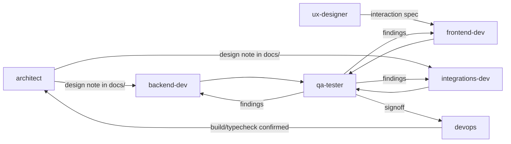

# Team workflow

How the `.claude/agents/` dev team (architect, backend-dev, integrations-dev,
frontend-dev, ux-designer, qa-tester, devops) actually works together on this repo.

## Roles and handoffs

Nobody works in isolation: `architect` and `ux-designer` decide *what* and *why* before
`backend-dev`/`integrations-dev`/`frontend-dev` build it; `qa-tester` checks the result
against the original intent, not just "does it compile"; `devops` has the final say on
whether it's actually safe to merge (build, typecheck, migrations).

## Communication channel

This is a file-based team, not a live chat: agents are invoked fresh per task and don't
share memory with each other directly. The repo itself is the shared memory:

- **`docs/team-log.md`** -- an append-only journal. Every agent adds one entry when it
  starts a task and one when it finishes, stating what it did, why, and who it's handing
  off to. Read the last ~20 entries before starting anything non-trivial so you're not
  duplicating or contradicting work another agent just did.
- **`docs/architecture.md`** -- the decisions log and flow diagram. Update it when a
  cross-cutting decision changes (new provider, new agent, new flow), not just the log.
- Design notes for anything spanning more than one package go in `docs/` as their own
  short file (e.g. `docs/going-live.md`), linked from `architecture.md`, not left only in
  a PR description that nobody will read later.

## Branching, review, and merge

1. One feature = one branch, named `<role>/<short-description>` (e.g.
   `backend-dev/trip-revision-agent`, `integrations-dev/reviews-provider`).
2. Commit as you go with real, specific messages -- not "wip" / "fixes".
3. **Before merging to `main`, run a code review on the diff** (the `/code-review` skill,
   or an equivalent review pass) and address what it finds. This is a hard gate, not a
   suggestion -- qa-tester or whichever agent is finishing the branch runs it.
4. Merge to `main` only after: code review is addressed, `npm run typecheck` passes, and
   (for anything touching `apps/web`) `npm run build -w apps/web` passes.
5. Push `main` to `origin` after merging so the remote stays current.
6. Log the merge in `docs/team-log.md`: branch name, one-line summary, who reviewed it.

If two in-flight branches are likely to touch the same files (e.g. both touch
`packages/core/src/orchestrator.ts`), don't run them concurrently -- finish and merge one
before starting the other, and say so in the log entry so the next agent knows why.
